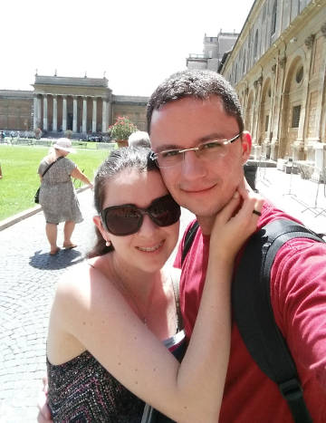

Introduction
------------

My name is Diogo Melo and I am from Brazil. I live in São Carlos, São Paulo.
I am a software developer and movie/chocolate/coffee lover.

- GitHub:  [/dmelo](https://github.com/dmelo)
- StackOverflow: [/diogo-melo](http://stackoverflow.com/users/408195/diogo-melo)
- Email: [dmelo87@gmail.com](mailto:dmelo87@gmail.com)

Work
------

I got my bachelor's degree in Computer Science from the University of São
Paulo, at the beginning of 2010. My undergraduate research was around robot
soccer. In 2006 I designed and implemented strategies for robot soccer. During
2007 and part of 2008 I implemented a robot soccer simulator. The source code
is open and can be found on GitHub
[dmelo/uspds](https://github.com/dmelo/uspds.git).

Between 2011 and 2013 I went on pursuing my master's degree, also at the
University of São Paulo. The subject of the research was data visualization and
relevance feedback applied to information retrieval. The dissertation can be
found at
[USP's digital library](http://www.teses.usp.br/teses/disponiveis/55/55134/tde-10072014-143431/en.php).

Currently, I work at [von Braun labs](http://vonbraunlabs.com.br/), as a
software developer. There I work on a wide variety of projects. Our technology
stack is chosen to be the best for each project. So, we end up working with
many different programming languages, frameworks and platforms. This is great both
for the projects we develop and for self-growth.

Personal life
-------------

I like getting involved with open software projects. See the
[projects](projects) page for more details. I consider computers, 
and everything that comes with them, to be the greatest achievement of mankind.
The ability to "transfer" thoughts from my mind to a system and keep it running
forever is the closest thing I know to magic. It fascinates me.

I also like spending time with family and friends. I really enjoy getting myself
into activities I know nothing or little about: climbing, archery,
food/wine/beer/coffee/chocolate tasting, cooking and so on.
